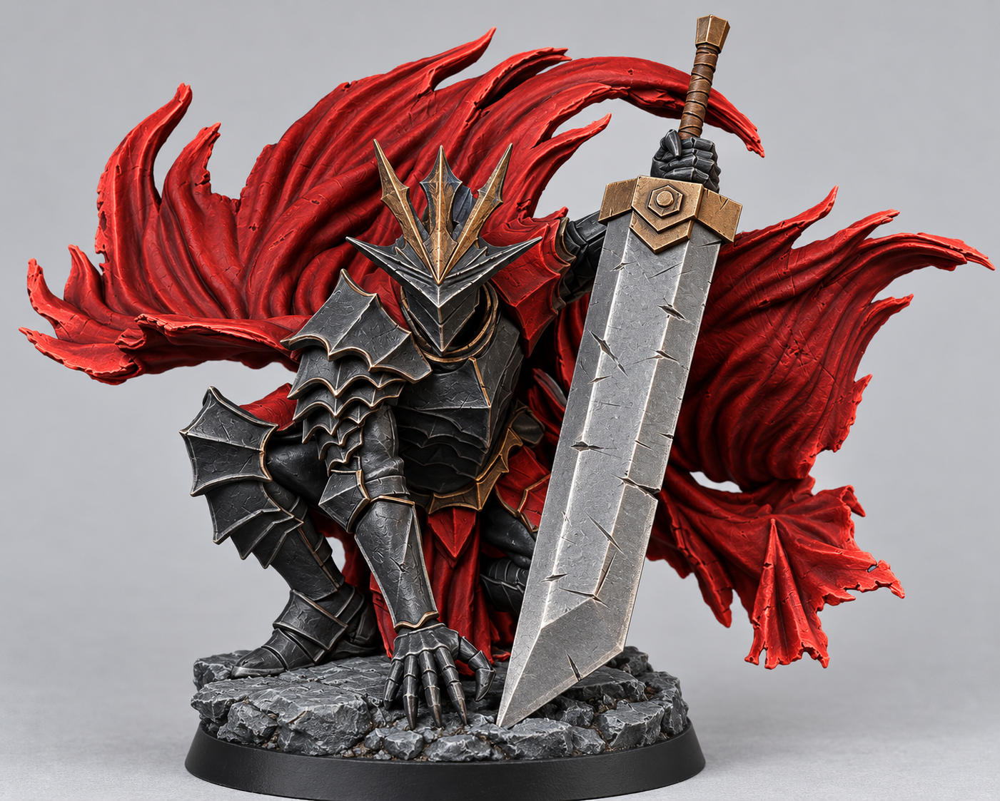
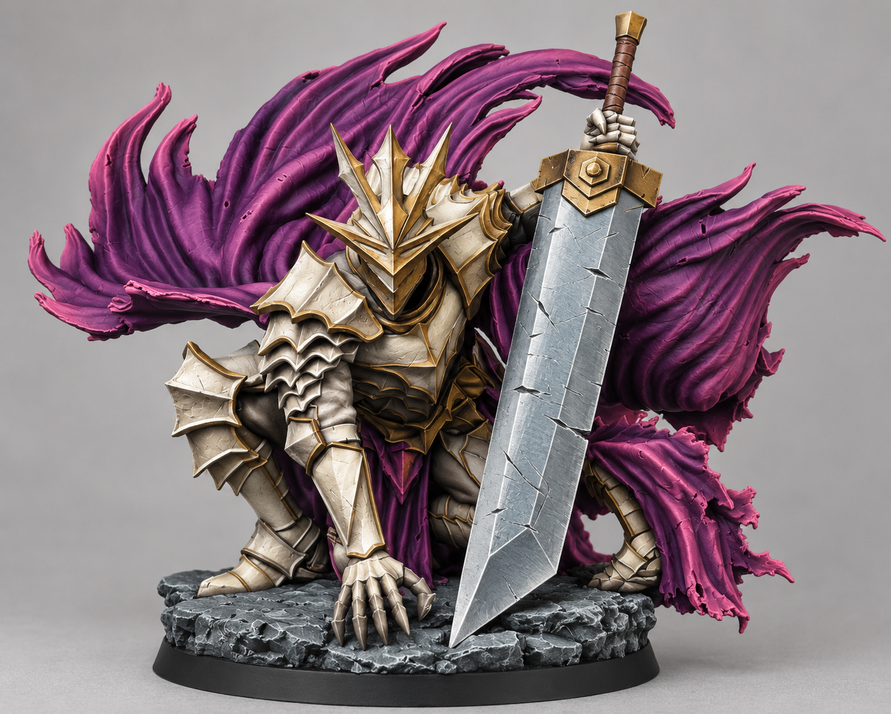
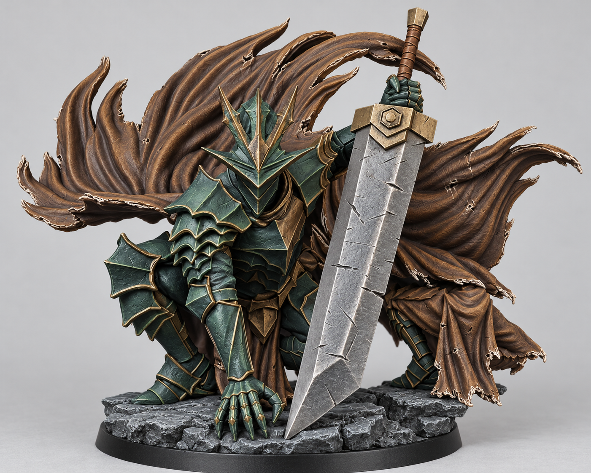
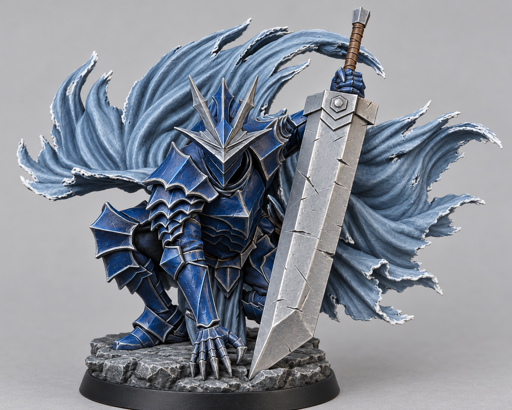
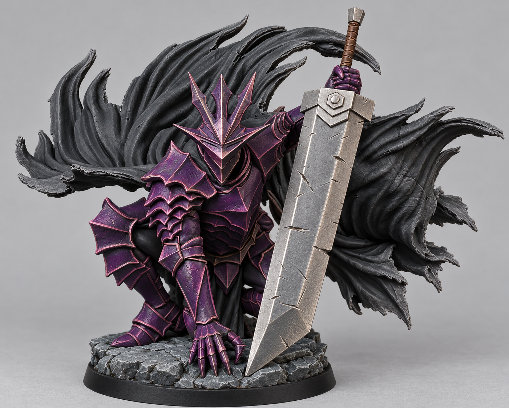

# Kneeling Warrior — Five Color Schemes

All five schemes use only normal Base/Layer paints from paint-inventory.md, including its metallic Base paints. No SpeedPaint or Contrast paint is used. All colors are used straight from the bottle: no pigment mixtures and no mixing ratios. Apply the colors listed for each surface as separate layers, leaving the darker color visible in recesses.

These AI-generated images are visual concepts, not exact paint or finish simulations; use the recipes below as the paint reference.

## Shared details

- Leather and sword grip: Army Paints Oak Brown #432010; raised wraps Reaper Woodland Brown #A17035.
- Rocky base: Citadel Mechanicus Standard Grey #39484B; drybrush texture with Citadel Grey Seer #A1A5A8 (a Base paint used with a drybrush).
- Base rim and deep gaps between armor plates: Citadel Abaddon Black #000000.
- No flesh paint is required: the sculpt is enclosed in armor.
- Metallic paints provide their own reflections; keep colored armor matte and apply highlights sparingly.

## 1. Crimson Oath

| Area | Paint placement (separate layers; no mixing) |
| --- | --- |
| Armor | Abaddon Black #000000, raised armor edges Eshin Grey #535659 |
| Cloak and cloth | Khorne Red #6A0A01 in recesses, Mephiston Red #9B0E05 on main cloth, Evil Eye Red #E65445 on frayed edges |
| Trim and sword fittings | Retributor Armour #997144 |
| Sword blade | Leadbelcher #888D8F with Filigree Silver #B5AFAD edges |

## 2. Ivory Vow

| Area | Paint placement (separate layers; no mixing) |
| --- | --- |
| Armor | Rakarth Flesh #ABA495 shaded panels, Bleached Linen #F1E8D9 broad plates, White Scar #FFFFFF fine edges |
| Cloak and cloth | Phoenician Purple #440052 in folds, Wyrm Blood #92606E raised cloth, Emperor's Childred #BD3F75 fine frayed edges |
| Trim and sword fittings | Retributor Armour #997144 |
| Sword blade | Grey Knights Steel #899AA4 with Filigree Silver #B5AFAD edges |

## 3. Verdant Warden

| Area | Paint placement (separate layers; no mixing) |
| --- | --- |
| Armor | Waaagh Flesh #0A3B37 deep panels, German Cam Dark Green #2F4845 main plates, Poisoned Leaf #427C6D edges |
| Cloak and cloth | Chocolate Brown #5F5047 folds, Woodland Brown #A17035 raised cloth, Bleached Linen #F1E8D9 only fine worn threads |
| Trim and sword fittings | Dragon Bronze #968354 |
| Sword blade | Leadbelcher #888D8F with Filigree Silver #B5AFAD edges |

## 4. Frostbound Knight

| Area | Paint placement (separate layers; no mixing) |
| --- | --- |
| Armor | Dark Prussian Blue #192C43 recesses, Kantor Blue #06234F main plates, Lothern Blue #2C9ACB fine edges |
| Cloak and cloth | Heather Blue #547C95 folds, Blue Horizon #9EB5CE raised cloth, White Scar #FFFFFF frayed edges |
| Trim and sword fittings | Grey Knights Steel #899AA4 |
| Sword blade | Grey Knights Steel #899AA4 with Filigree Silver #B5AFAD edges |

## 5. Amethyst Revenant

| Area | Paint placement (separate layers; no mixing) |
| --- | --- |
| Armor | Phoenician Purple #440052 main plates, Wyrm Blood #92606E raised edges, Emperor's Childred #BD3F75 very fine corner highlights |
| Cloak and cloth | Abaddon Black #000000 deep folds, Dark Grey #2D373A main cloth, Eshin Grey #535659 frayed edges |
| Trim and sword fittings | Filigree Silver #B5AFAD |
| Sword blade | Leadbelcher #888D8F with Filigree Silver #B5AFAD edges |

## Paint brand key

- Citadel: Abaddon Black, Eshin Grey, Khorne Red, Mephiston Red, Retributor Armour, Leadbelcher, Rakarth Flesh, White Scar, Phoenician Purple, Grey Knights Steel, Waaagh Flesh, Kantor Blue, Lothern Blue, Blue Horizon, Mechanicus Standard Grey, Grey Seer, Emperor's Childred (inventory spelling).
- Army Paints: Wyrm Blood, Poisoned Leaf, Oak Brown.
- Reaper: Bleached Linen, Filigree Silver, Woodland Brown, Dragon Bronze, Heather Blue.
- Vallejo: German Cam Dark Green, Chocolate Brown, Dark Prussian Blue, Dark Grey.
- Two Thin Coats: Evil Eye Red.

