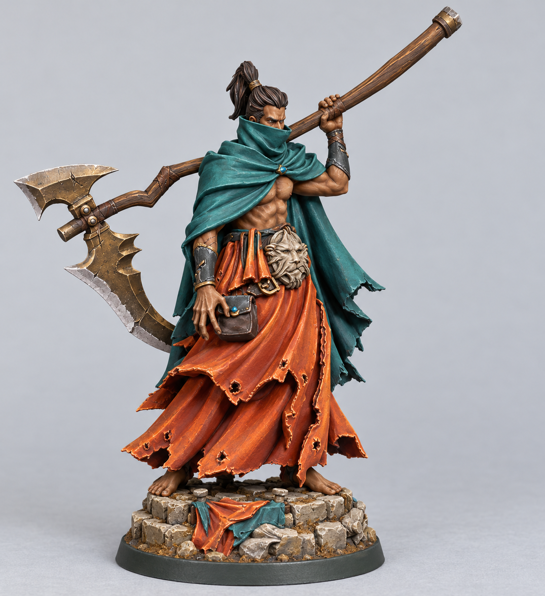
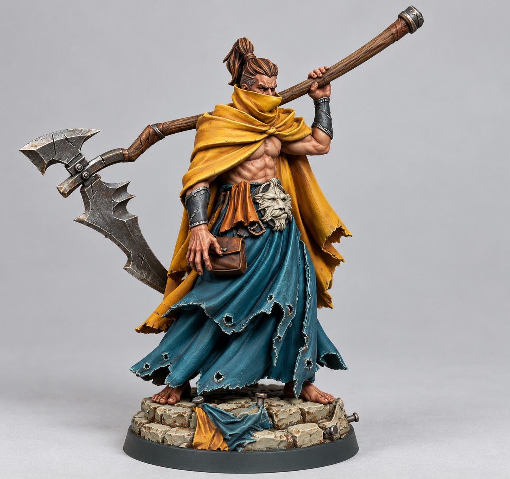
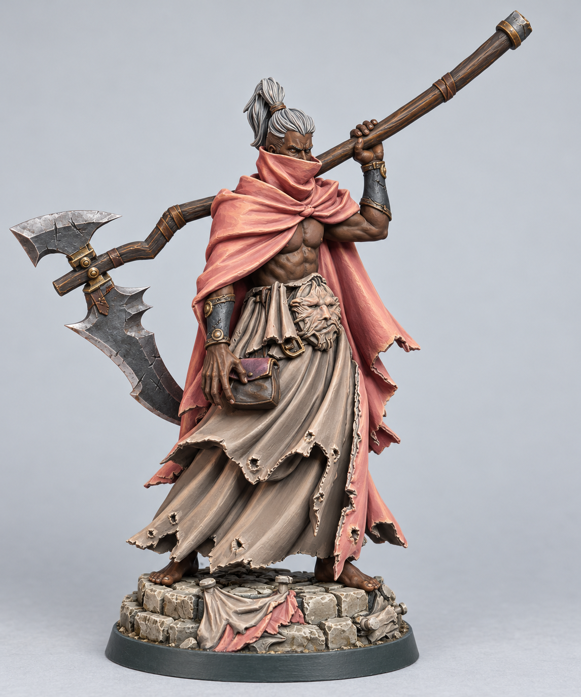
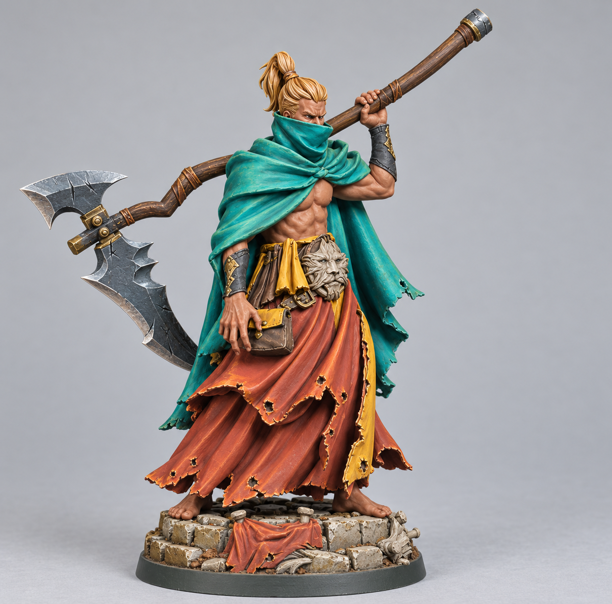
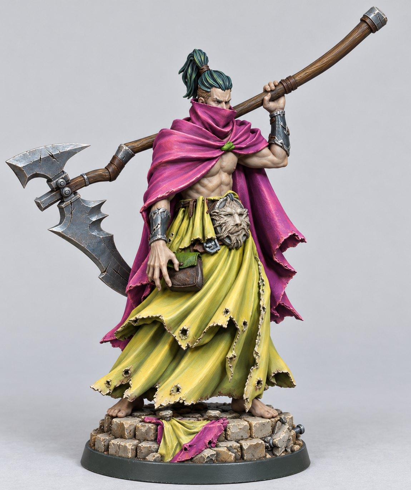

# Unholy Priest — Expanded Mixed Palettes

These five new schemes use only paints in paint-inventory.md. Normal and SpeedPaint colors may be mixed under your revised preference. Original schemes are preserved in the neighboring folder.

## Measuring the mixes

Ratios are suggested starting recipes, not experimentally verified paint matches. One part means one equal volume of paint: for example, 4:1 can be four similarly sized drops of normal paint to one drop of SpeedPaint. If droppers differ, measure equal volumes with the same tool. Shake each bottle first. Make a small sample and let it dry before committing to the miniature; the images cannot predict actual pigment mixing, coverage, finish or drying behavior. Ratios describe paint only, before any thinning. For highlights made from a completed mix, prepare the base recipe first, then measure that mixture as a single ingredient.

Generated using the built-in image_gen tool. Images are approximate visual targets, with neutral lighting. Follow recipes below where fine details differ.

## Shared details

| Surface | Paints and placement |
| --- | --- |
| Wooden shaft, straps | Army Paints Oak Brown #432010; Reaper Woodland Brown #A17035 raised grain and edges, separate layers |
| Pouch body | Vallejo Chocolate Brown #5F5047; scheme accent on flap |
| Waist ornament | Citadel Rakarth Flesh #ABA495, then Reaper Bleached Linen #F1E8D9 on raised details |
| Forearm guards | Vallejo Dark Grey #2D373A, scheme metal on fittings |
| Stone base | Citadel Steel Legion Drab #584D2D shadows; Citadel Rakarth Flesh #ABA495 main stone; Reaper Bleached Linen #F1E8D9 drybrush |
| Base rim | Vallejo Olive Brown #3B4947 |
| Base drapery | Scheme robe colors |

## 1. Copper Tide

| Surface | Recipe and placement |
| --- | --- |
| Cloak and scarf | Deep teal: 4 parts Army Paints Poisoned Leaf #427C6D + 1 part Army Paints SpeedPaint Lizard folk Cyan #339DA3. Separate fine edge highlights Poisoned Leaf. |
| Robes | Burnished orange: 4 parts Army Paints Demigod Flames #D27933 + 1 part Army Paints SpeedPaint Slaughter Red #9E1023. Separate fine edges Citadel Fire Dragon Bright #F4874E. |
| Skin | Reaper Dark Highlights #422B19 base; Reaper Woodland Brown #A17035 raised areas |
| Hair | Reaper Ebony Flesh #130C04 with Dark Highlights #422B19 strands |
| Metal | Reaper Dragon Bronze #968354 fittings and blade body, Reaper Filigree Silver #B5AFAD cutting edge |
| Accents | Army Paints Aesir Gem #0683C3 scarf knot and pouch flap |

## 2. Saffron Plague

| Surface | Recipe and placement |
| --- | --- |
| Cloak and scarf | Rich saffron: 5 parts Citadel Averland Sunset #FBBA00 + 1 part Army Paints SpeedPaint Satchel Brown #5C3729. Separate highlights Reaper Marigold Yellow #EE922B and tiny Two Thin Coats Craven Yellow #F7F25A edges. |
| Robes | Petrol blue-green: 3 parts Army Paints Deep Ocean Blue #213242 + 1 part Army Paints SpeedPaint Lizard folk Cyan #339DA3. Separate fine edges Reaper Heather Blue #547C95. |
| Skin | Citadel Bugman's Glow #8C5144 base; Reaper Tawny Flesh #E4B895 raised areas |
| Hair | Army Paints Oak Brown #432010 with Reaper Woodland Brown #A17035 strands |
| Metal | Citadel Leadbelcher #888D8F blade and fittings; Reaper Filigree Silver #B5AFAD edges |
| Accents | Army Paints Demigod Flames #D27933 pouch flap and small waist cloth |

## 3. Rose Ash Oracle

| Surface | Recipe and placement |
| --- | --- |
| Cloak and scarf | Dusty coral rose: 5 parts Reaper Bleached Linen #F1E8D9 + 1 part Army Paints SpeedPaint Familiar Pink #DF2988 + 1 part Army Paints SpeedPaint Peachy Flesh #F6A869. Highlight mixture 2 parts this completed mix + 1 part Bleached Linen. |
| Robes | Warm ash taupe: 4 parts Citadel Rakarth Flesh #ABA495 + 1 part Army Paints SpeedPaint Satchel Brown #5C3729. Separate highlights Reaper Bleached Linen #F1E8D9. |
| Skin | Reaper Ebony Flesh #130C04 base; Reaper Dark Highlights #422B19 then Woodland Brown #A17035 small raised areas |
| Hair | Citadel Grey Seer #A1A5A8 with White Scar #FFFFFF strands |
| Metal | Reaper Dragon Bronze #968354 fittings; Citadel Leadbelcher #888D8F blade with Filigree Silver #B5AFAD edge |
| Accents | Army Paints Wyrm Blood #92606E pouch flap and scarf knot |

## 4. Jade Sun Exile

| Surface | Recipe and placement |
| --- | --- |
| Cloak and scarf | Bright jade turquoise: 3 parts Army Paints Dryad Green #76C043 + 2 parts Vallejo Deep Sky Blue #00A6DA + 1 part Army Paints SpeedPaint Lizard folk Cyan #339DA3. Fine highlights 3 parts completed mix + 1 part Pro Acrylic Bold Titanium White #FFFFFF. |
| Robes | Warm terracotta: 3 parts Army Paints Topaz Skin #b5574E + 1 part Army Paints Demigod Flames #D27933. Separate fine edges Citadel Fire Dragon Bright #F4874E. |
| Skin | Citadel Bugman's Glow #8C5144 base; Reaper Tawny Flesh #E4B895 raised areas |
| Hair | Reaper Marigold Yellow #EE922B with Reaper Bleached Linen #F1E8D9 strands, ochre blond |
| Metal | Citadel Retributor Armour #997144 fittings; Citadel Grey Knights Steel #899AA4 blade, Filigree Silver #B5AFAD edge |
| Accents | Citadel Averland Sunset #FBBA00 narrow waist cloth and pouch flap |

## 5. Orchid Venom

| Surface | Recipe and placement |
| --- | --- |
| Cloak and scarf | Vivid orchid: 4 parts Citadel Emperor's Childred #BD3F75 + 1 part Army Paints SpeedPaint Purple Swarm #623089. Highlight 3 parts completed mix + 1 part Reaper Bleached Linen #F1E8D9. |
| Robes | Pale chartreuse: 4 parts Army Paints Hobgoblin Yellow #FEEE8E + 1 part Citadel Moot Green #57AA2D + 1 part Army Paints SpeedPaint Zealot Yellow #FEC800. Separate small highlights Hobgoblin Yellow. |
| Skin | Citadel Rakarth Flesh #ABA495 base; Reaper Bleached Linen #F1E8D9 raised areas |
| Hair | Army Paints Polymorph Green #193B44 with Army Paints Poisoned Leaf #427C6D strands, deep green black |
| Metal | Citadel Grey Knights Steel #899AA4 blade and fittings with Reaper Filigree Silver #B5AFAD edges |
| Accents | Citadel Moot Green #57AA2D pouch flap and scarf knot |

