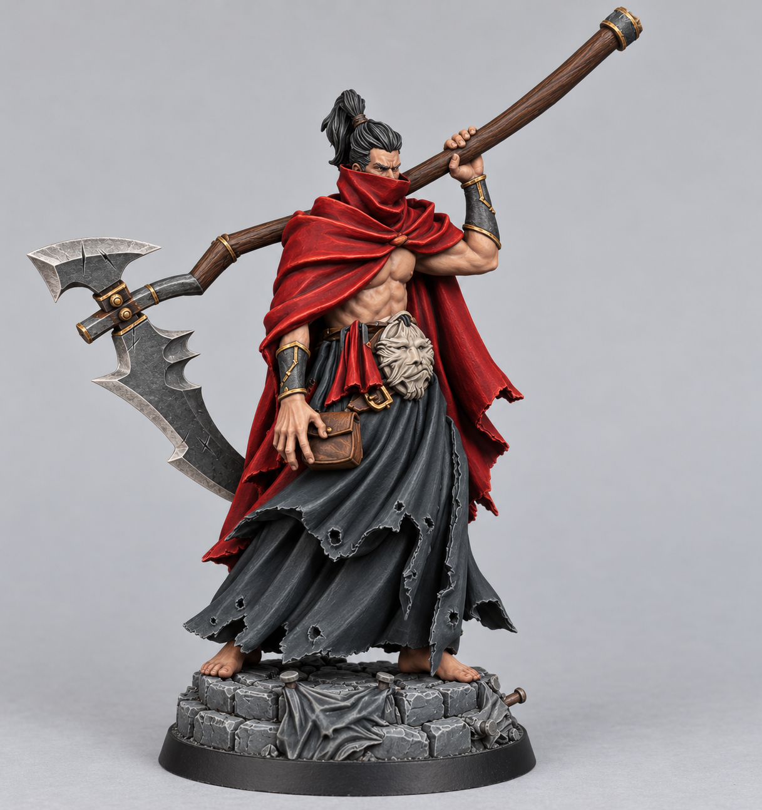
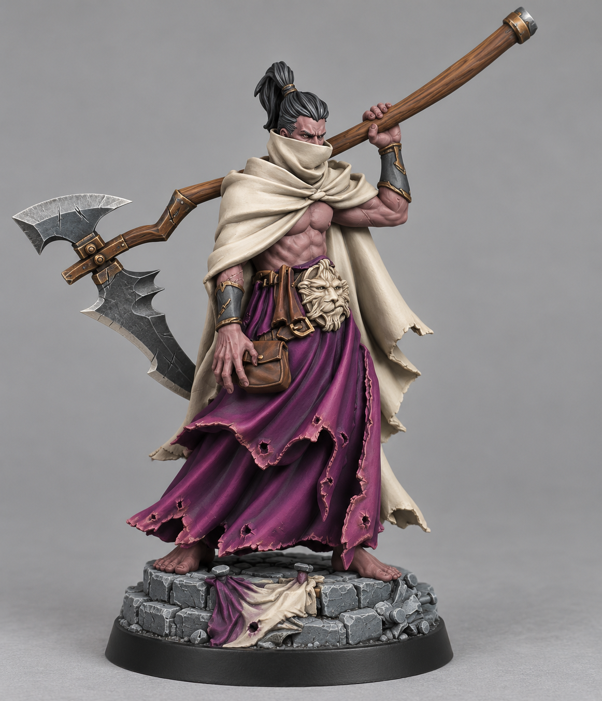
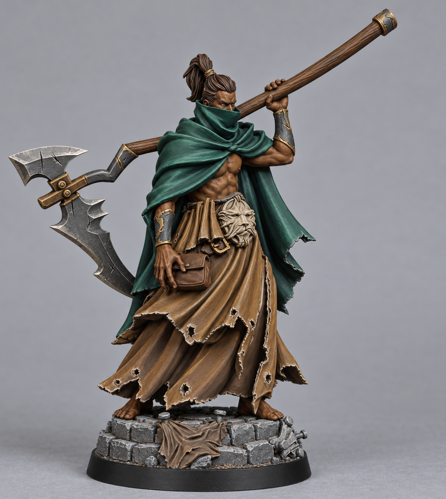
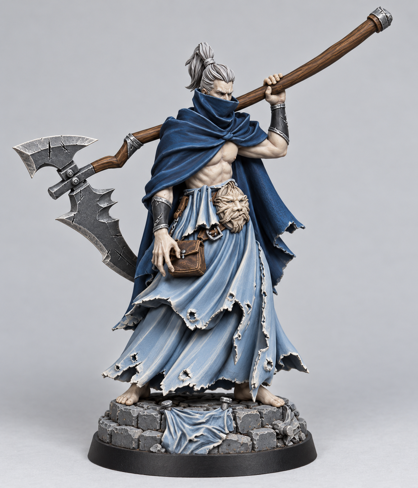
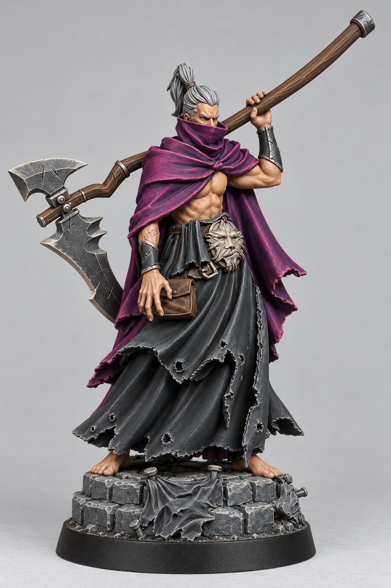

# Unholy Priest with Scythe — Five Color Schemes

All paints are normal Base/Layer paints from paint-inventory.md, including metallic Base paints. No SpeedPaint or Contrast paints, pigment mixtures, washes, shades, or effects are used. Every listed color is applied separately, so no mixing ratios are needed. Layer progressively smaller areas of the lighter colors, preserving darker recesses.

Generated images are visual concepts, not exact pigment or finish simulations. Follow these recipes for paint selection. Where generated cloth accents vary, the table defines the intended placement.

## Shared details

| Area | Separate paint layers |
| --- | --- |
| Scythe blade | Citadel Leadbelcher #888D8F; Reaper Filigree Silver #B5AFAD cutting edges |
| Wooden shaft, belt and pouch | Army Paints Oak Brown #432010; Reaper Woodland Brown #A17035 raised grain and edges |
| Waist face ornament | Citadel Rakarth Flesh #ABA495; Reaper Bleached Linen #F1E8D9 raised details |
| Forearm guards | Vallejo Dark Grey #2D373A; Citadel Eshin Grey #535659 edges; scheme-specific metal trim |
| Masonry | Citadel Mechanicus Standard Grey #39484B; drybrush Citadel Grey Seer #A1A5A8 |
| Base rim and deepest gaps | Citadel Abaddon Black #000000 |
| Fabric draped on base | Use the scheme's robe paints |

## 1. Crimson Hierophant

| Area | Separate paint layers |
| --- | --- |
| Cloak and face scarf | Khorne Red #6A0A01 recesses, Mephiston Red #9B0E05 main cloth, Evil Eye Red #E65445 fine edges |
| Layered robes and waist cloth | Abaddon Black #000000 recesses, Dark Grey #2D373A main cloth, Eshin Grey #535659 edges |
| Exposed skin | Bugman's Glow #8C5144 shadows, Tawny Flesh #E4B895 raised skin |
| Hair and ponytail | Abaddon Black #000000 with Eshin Grey #535659 strands |
| Buckles, scythe fittings and guard trim | Retributor Armour #997144 |

## 2. Ivory Heretic

| Area | Separate paint layers |
| --- | --- |
| Cloak and face scarf | Rakarth Flesh #ABA495 shadows, Bleached Linen #F1E8D9 main cloth, White Scar #FFFFFF fine edges |
| Layered robes and waist cloth | Phoenician Purple #440052 main cloth, Wyrm Blood #92606E raised folds, Emperor's Childred #BD3F75 fine edges |
| Exposed skin | Carnelian Skin #66494D shadows, Wyrm Blood #92606E main skin, Rakarth Flesh #ABA495 small raised highlights, pallid fantasy complexion |
| Hair and ponytail | Abaddon Black #000000 with Eshin Grey #535659 strands |
| Buckles, scythe fittings and guard trim | Dragon Bronze #968354 |

## 3. Rotwood Prophet

| Area | Separate paint layers |
| --- | --- |
| Cloak and face scarf | Waaagh Flesh #0A3B37 shadows, German Cam Dark Green #2F4845 main cloth, Poisoned Leaf #427C6D raised folds |
| Layered robes and waist cloth | Chocolate Brown #5F5047 shadows, Woodland Brown #A17035 main cloth, Rakarth Flesh #ABA495 fine edges |
| Exposed skin | Ebony Flesh #130C04 shadows, Dark Highlights #422B19 main skin, Woodland Brown #A17035 small raised highlights, dark warm complexion |
| Hair and ponytail | Ebony Flesh #130C04 with Dark Highlights #422B19 strands |
| Buckles, scythe fittings and guard trim | Dragon Bronze #968354 |

## 4. Winter Sepulcher

| Area | Separate paint layers |
| --- | --- |
| Cloak and face scarf | Dark Prussian Blue #192C43 shadows, Kantor Blue #06234F main cloth, Heather Blue #547C95 edges |
| Layered robes and waist cloth | Heather Blue #547C95 shadows, Blue Horizon #9EB5CE main cloth, Bleached Linen #F1E8D9 fine edges |
| Exposed skin | Rakarth Flesh #ABA495 shadows, Bleached Linen #F1E8D9 main skin, White Scar #FFFFFF tiny raised highlights, pallid complexion |
| Hair and ponytail | Grey Seer #A1A5A8 with White Scar #FFFFFF strands |
| Buckles, scythe fittings and guard trim | Grey Knights Steel #899AA4 |

## 5. Violet Eclipse

| Area | Separate paint layers |
| --- | --- |
| Cloak and face scarf | Phoenician Purple #440052 main cloth, Wyrm Blood #92606E raised folds, Emperor's Childred #BD3F75 fine edges |
| Layered robes and waist cloth | Abaddon Black #000000 shadows, Dark Grey #2D373A main cloth, Eshin Grey #535659 fine edges |
| Exposed skin | Bugman's Glow #8C5144 shadows, Tawny Flesh #E4B895 main skin, Bleached Linen #F1E8D9 small raised highlights |
| Hair and ponytail | Grey Seer #A1A5A8 with White Scar #FFFFFF strands |
| Buckles, scythe fittings and guard trim | Filigree Silver #B5AFAD |

## Paint brand key

- Citadel: Khorne Red, Mephiston Red, Abaddon Black, Eshin Grey, Bugman's Glow, Retributor Armour, Rakarth Flesh, White Scar, Phoenician Purple, Emperor's Childred (inventory spelling), Waaagh Flesh, Kantor Blue, Blue Horizon, Grey Seer, Grey Knights Steel, Leadbelcher, Mechanicus Standard Grey.
- Army Paints: Wyrm Blood, Carnelian Skin, Poisoned Leaf, Oak Brown.
- Reaper: Tawny Flesh, Bleached Linen, Dragon Bronze, Ebony Flesh, Dark Highlights, Woodland Brown, Heather Blue, Filigree Silver.
- Vallejo: Dark Grey, German Cam Dark Green, Chocolate Brown, Dark Prussian Blue.
- Two Thin Coats: Evil Eye Red.

